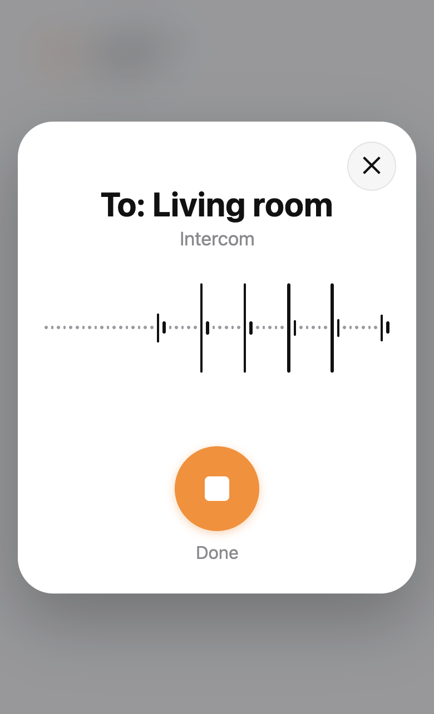
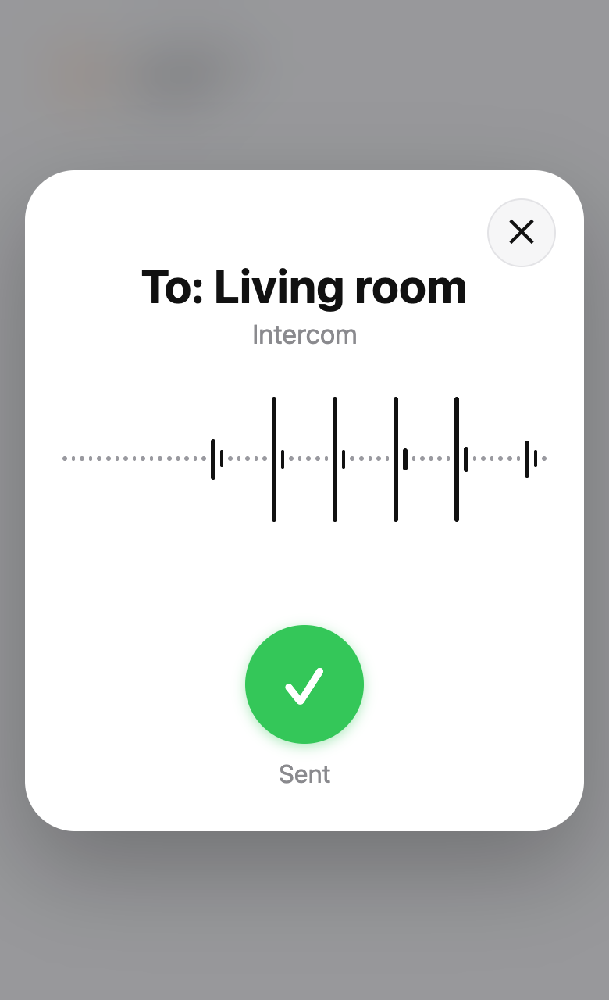

# Intercom for Home Assistant

[Polska wersja](README.pl.md)

Voice messages to the rooms of your house. Tap the card, speak, tap **Done**: the message plays in the
room (or the whole house) on the first speaker of each room that answers, whether that is a HomePod,
a Sonos, a Google speaker or a Home Assistant voice satellite.

- **One action for everything:** `intercom.announce` speaks a text or plays a recording in rooms and
  tells where it was heard. Automations use it too.
- **A card for any dashboard:** `custom:intercom-card` records the message in the browser (phone,
  tablet, computer) in a window like a phone's intercom, with the live wave of your voice.
- **Every signed-in user can send**, not only administrators: recordings go to the integration, not
  to the media folder, and are removed after 15 minutes.
- **Rooms set up by themselves:** each area's media players and voice satellites are found when the
  integration is added; you choose their order in the options.
- **Speakers that drop streamed speech** (an Apple TV / HomePod) get the whole spoken message as a
  file.
- **Say it to your voice assistant:** "Announcement to the kitchen, dinner is ready" plays in the
  kitchen, with [Assist Router](https://github.com/witold-gren/home-assistant-assist-router), even in
  your own voice.

<p align="center">
  
  
</p>

## Requirements

- Home Assistant 2026.2 or newer.
- A text-to-speech engine for typed messages (e.g. Piper, Google Translate, Home Assistant Cloud).
- Recording a voice message needs the dashboard over **HTTPS** (browsers allow the microphone only
  there). Over plain HTTP the card falls back to a text field (use the keyboard's dictation).

## Installation

### HACS

1. HACS → three dots → **Custom repositories** → add this repository as an **Integration**.
2. Install **Intercom** and restart Home Assistant.

### Manual

Copy `custom_components/intercom` to `config/custom_components/intercom` and restart Home Assistant.

## Setup

**Settings → Devices & services → Add integration → Intercom.** Every area with a media player or a
voice satellite becomes a room: its voice satellites first, then its media players (televisions and a
satellite's own player are left out; Apple TV / HomePod players get whole files). Then, in
**Configure**:

| Option | What it does |
|---|---|
| **A room and its speakers** | The menu lists the rooms with their speakers. Choose a room (or another area to add), then its speakers in the order they are tried. *Play as a whole file* for speakers that drop streamed speech (Apple TV / HomePod). *Volume of messages* (empty: the speaker's own). *Remove this room*. |
| **Voice and recordings** | The text-to-speech engine and its language (empty: Home Assistant's first engine and language) then the engine's voice when it offers more than one (empty: its default; voice satellites keep their assistant's voice), and how long messages are kept (15 minutes). |

## The card

```yaml
type: custom:intercom-card
areas: [living_room]   # optional: without it, the whole house
name: Living room      # optional
icon: mdi:account-voice
```

Tap it, speak, tap **Done** (or **✕** to cancel). A message is at most 30 seconds long.

## The action

```yaml
action: intercom.announce
data:
  areas: [kitchen, living_room]   # areas, or entities in them
  message: Dinner is ready!       # or media: media-source://...
  volume: 0.5                     # optional, 0-1
response_variable: result
```

`result` is `{"played": [{area, area_name, speaker, speaker_name}], "missing": [area]}`: a room is
missing when none of its speakers is up or its speaker failed.

## Voice assistant

With [Assist Router](https://github.com/witold-gren/home-assistant-assist-router) (0.1.5 or newer) as
the conversation agent of a voice pipeline, a sentence that starts with "announcement", "intercom" or
"to everyone" (in Polish „ogłoszenie”, „komunikat”, „do wszystkich”, „interkom”) goes through the
intercom:

- **Rooms named in the sentence** get it: "Announcement to the kitchen and the bedroom, dinner is
  ready" (inflected names and area aliases count). Without a room named, every room but the one you
  are speaking in.
- **Your own voice:** with [Assist Speaker ID](https://github.com/witold-gren/home-assistant-assist-speaker-id)
  the rooms hear your recording; without it, the message read by text to speech.
- HomePods and other whole-file speakers get it as a file, as with the card.
- The assistant answers "Announcement sent", or that no speaker answered.

In the voice assistant turn off **Prefer handling commands locally**: otherwise Home Assistant's
built-in broadcast takes the sentence first and reads it on every satellite.

Any other conversation agent or automation can call `intercom.announce`. Other integrations can use
`custom_components.intercom.api`: `is_set_up`, `areas_in_text` and `async_announce` (a text, or the
bytes of a recording, to named rooms or to every room but one).

## For other dashboards

- `POST /api/intercom/message?areas=<area>,<area>[&volume=0.5]` with the recording as the body
  (`audio/wav`, `audio/webm`, `audio/ogg`, `audio/mp4` or `audio/mpeg`, at most 5 MB) answers with the
  result above. Any signed-in user may call it.
- WebSocket `{"type": "intercom/rooms"}` gives the rooms: `{"rooms": [{area, name, ready}]}`.

## FAQ

**The card shows a text field instead of recording.** The browser does not offer the microphone: the
dashboard is not on HTTPS, or the microphone permission was denied. Open Home Assistant over HTTPS
and allow the microphone for it.

**"No speaker answered".** None of the room's speakers is up (unavailable or unknown; a whole-file
speaker also when it is off, as Apple TV shows a HomePod it lost). Check them, or
add another speaker to the room in the options.

**A HomePod says nothing for typed messages.** Tick it under *Play as a whole file* for its room:
it then gets the whole spoken message instead of a stream.

**The voice assistant reads "Announcement, ..." as a question.** The pipeline's conversation agent
is not Assist Router, or Assist Router is older than 0.1.5. Choose Assist Router in the voice
assistant's settings; with another agent, call `intercom.announce` from a sentence trigger.

**The end of a message is cut off on a HomePod.** Over AirPlay the sender closes the stream about
1.5 s after the last sound, while a HomePod still holds up to 2 s in its buffer. From 0.1.3 the
intercom adds 2 s of silence at the end of a WAV message for whole-file speakers: tick the HomePod
under *Play as a whole file* for its room. Recordings in other formats (webm, mp3) are played as
they came.

**"No text-to-speech engine".** Typed messages need a text-to-speech engine: add one, or choose it
under *Voice and recordings*. Recordings play without one.

## Development

`make help` lists the steps (`make setup`, `make test`, `make test-browser`, `make screenshots`,
`make lint`, `make deploy`).

## License

MIT
