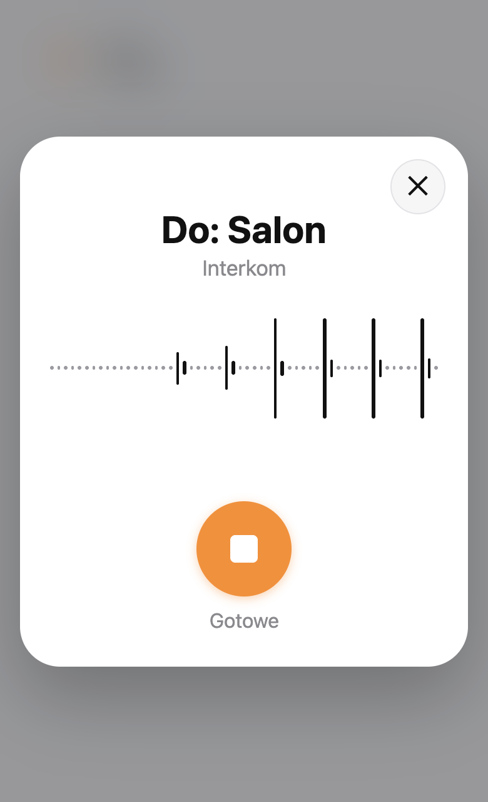
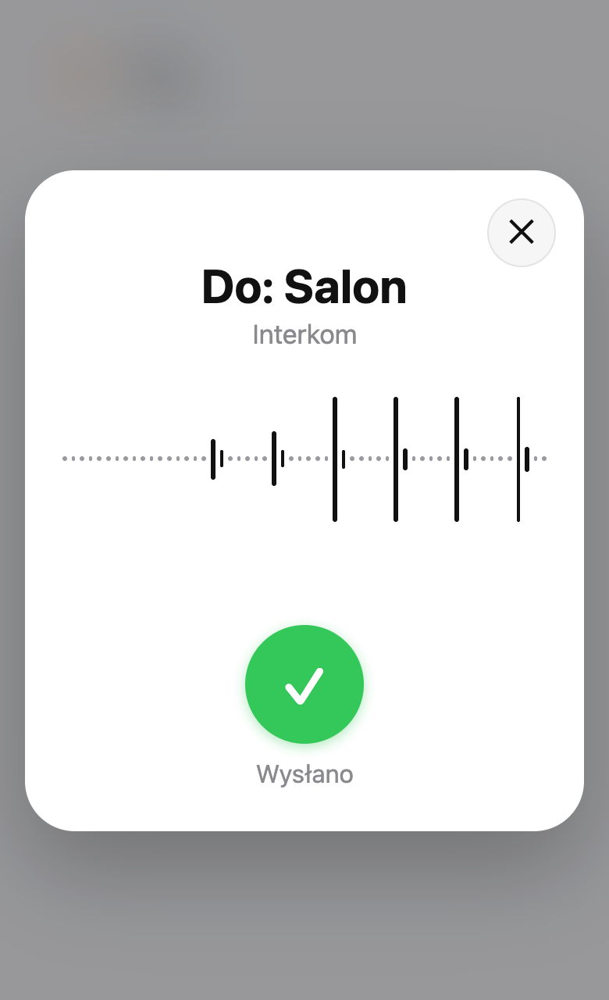

# Interkom dla Home Assistant

[English version](README.md)

Wiadomości głosowe do pokojów w domu. Dotykasz karty, mówisz, dotykasz **Gotowe**: wiadomość gra w
pokoju (albo w całym domu) na pierwszym głośniku każdego pokoju, który odpowiada: HomePodzie, Sonosie,
głośniku Google albo satelicie głosowym Home Assistant.

- **Jedna akcja do wszystkiego:** `intercom.announce` wypowiada tekst albo odtwarza nagranie w
  pokojach i mówi, gdzie zostało usłyszane. Korzystają z niej też automatyzacje.
- **Karta do każdego dashboardu:** `custom:intercom-card` nagrywa wiadomość w przeglądarce (telefon,
  tablet, komputer) w oknie jak interkom w telefonie, z falą głosu na żywo.
- **Wysłać może każdy zalogowany użytkownik**, nie tylko administrator: nagrania trafiają do
  integracji, a nie do folderu mediów, i znikają po 15 minutach.
- **Pokoje ustawiają się same:** przy dodaniu integracji znajduje odtwarzacze i satelity w każdym
  obszarze; kolejność wybierasz w opcjach.
- **Głośniki, które nie radzą sobie z mową przesyłaną strumieniowo** (Apple TV / HomePod), dostają
  całą wypowiedź jako plik.
- **Wystarczy powiedzieć asystentowi głosowemu:** „Komunikat do kuchni, obiad gotowy” zagra w
  kuchni, z [Assist Router](https://github.com/witold-gren/home-assistant-assist-router), także Twoim
  własnym głosem.

<p align="center">
  
  
</p>

## Wymagania

- Home Assistant 2026.2 lub nowszy.
- Silnik zamiany tekstu na mowę dla wiadomości pisanych (np. Piper, Google Translate, Home Assistant
  Cloud).
- Nagranie głosu wymaga dashboardu przez **HTTPS** (przeglądarki dają mikrofon tylko tam). Przez HTTP
  karta pokazuje pole tekstowe (można dyktować z klawiatury).

## Instalacja

### HACS

1. HACS → trzy kropki → **Własne repozytoria** → dodaj to repozytorium jako **Integracja**.
2. Zainstaluj **Intercom** i uruchom ponownie Home Assistant.

### Ręcznie

Skopiuj `custom_components/intercom` do `config/custom_components/intercom` i uruchom ponownie Home
Assistant.

## Konfiguracja

**Ustawienia → Urządzenia i usługi → Dodaj integrację → Intercom.** Każdy obszar z odtwarzaczem albo
satelitą głosowym staje się pokojem: najpierw jego satelity głosowe, potem odtwarzacze (bez
telewizorów i bez odtwarzacza samej satelity; odtwarzacze Apple TV / HomePod dostają całe pliki).
Potem w **Konfiguruj**:

| Opcja | Co robi |
|---|---|
| **Pokój i jego głośniki** | Menu pokazuje pokoje z ich głośnikami. Wybierz pokój (albo inny obszar, żeby go dodać), potem jego głośniki w kolejności, w jakiej są próbowane. *Odtwarzaj jako cały plik* dla głośników, które nie radzą sobie ze strumieniem (Apple TV / HomePod). *Głośność wiadomości* (puste: głośność głośnika). *Usuń ten pokój*. |
| **Głos i nagrania** | Silnik zamiany tekstu na mowę i jego język (puste: pierwszy silnik i język Home Assistant) potem głos silnika, gdy ma ich kilka (puste: domyślny; satelity głosowe mówią głosem swojego asystenta), oraz jak długo trzymać wiadomości (15 minut). |

## Karta

```yaml
type: custom:intercom-card
areas: [living_room]   # opcjonalnie: bez tego cały dom
name: Salon            # opcjonalnie
icon: mdi:account-voice
```

Dotknij, mów, dotknij **Gotowe** (albo **✕**, żeby anulować). Wiadomość trwa najwyżej 30 sekund.

## Akcja

```yaml
action: intercom.announce
data:
  areas: [kitchen, living_room]   # obszary albo encje w nich
  message: Obiad gotowy!          # albo media: media-source://...
  volume: 0.5                     # opcjonalnie, 0-1
response_variable: wynik
```

`wynik` to `{"played": [{area, area_name, speaker, speaker_name}], "missing": [area]}`: pokój jest
w `missing`, gdy żaden jego głośnik nie działa albo głośnik zawiódł.

## Asystent głosowy

Gdy agentem rozmowy w potoku głosowym jest [Assist Router](https://github.com/witold-gren/home-assistant-assist-router)
(0.1.5 lub nowszy), zdanie zaczynające się od „ogłoszenie”, „komunikat”, „do wszystkich” albo
„interkom” idzie przez interkom:

- **Pokoje wymienione w zdaniu**: „Komunikat do kuchni i sypialni, obiad gotowy”. Liczą się odmienione
  nazwy i aliasy obszarów. Bez nazwy pokoju wiadomość trafia wszędzie poza pokojem, w którym mówisz.
- **Twój własny głos:** z [Assist Speaker ID](https://github.com/witold-gren/home-assistant-assist-speaker-id)
  pokoje słyszą Twoje nagranie, bez niego wiadomość czytana syntezą mowy.
- HomePody i inne głośniki „całego pliku” dostają ją jako plik, tak jak z karty.
- Asystent odpowiada „Ogłoszenie wysłane” albo że żaden głośnik nie odpowiedział.

W asystencie głosowym wyłącz **Preferuj lokalną obsługę poleceń**: inaczej wbudowane ogłoszenie
Home Assistant przechwyci zdanie i przeczyta je na wszystkich satelitach.

Każdy inny agent rozmowy albo automatyzacja może wywołać `intercom.announce`. Inne integracje mogą
użyć `custom_components.intercom.api`: `is_set_up`, `areas_in_text` i `async_announce` (tekst albo
bajty nagrania, do wskazanych pokoi albo do wszystkich poza jednym).

## Dla innych dashboardów

- `POST /api/intercom/message?areas=<obszar>,<obszar>[&volume=0.5]` z nagraniem w treści
  (`audio/wav`, `audio/webm`, `audio/ogg`, `audio/mp4` albo `audio/mpeg`, najwyżej 5 MB) odpowiada
  wynikiem jak wyżej. Może go wywołać każdy zalogowany użytkownik.
- WebSocket `{"type": "intercom/rooms"}` podaje pokoje: `{"rooms": [{area, name, ready}]}`.

## FAQ

**Karta pokazuje pole tekstowe zamiast nagrywania.** Przeglądarka nie udostępnia mikrofonu: dashboard
nie jest otwarty przez HTTPS albo odmówiono dostępu do mikrofonu. Otwórz Home Assistant przez HTTPS i
zezwól na mikrofon.

**„Żaden głośnik nie odpowiedział”.** Żaden głośnik pokoju nie działa (jest niedostępny albo w stanie
nieznanym; głośnik „całego pliku” także wyłączony, bo tak Apple TV pokazuje HomePoda, z którym
straciło połączenie). Sprawdź go albo dodaj pokojowi inny głośnik w opcjach.

**HomePod milczy przy wiadomościach pisanych.** Zaznacz go w *Odtwarzaj jako cały plik* dla jego
pokoju: dostanie wtedy całą wypowiedź zamiast strumienia.

**Asystent głosowy traktuje „Komunikat, ...” jak pytanie.** Agentem rozmowy w potoku nie jest
Assist Router albo jest starszy niż 0.1.5. Wybierz Assist Router w ustawieniach asystenta głosowego;
z innym agentem wywołaj `intercom.announce` z wyzwalacza zdaniem.

**Koniec nagranej wiadomości jest obcięty.** Do wersji 0.1.5 karta przestawała nagrywać w chwili
dotknięcia **Gotowe**, przez co ginęła ostatnia sylaba i ok. 0,2 s dźwięku jeszcze w drodze z mikrofonu,
na każdym głośniku. Od 0.1.6 nagrywa pół sekundy dłużej. Dashboard z własnym rejestratorem potrzebuje
takiego samego ogona.

**Na HomePodzie koniec wiadomości jest obcięty.** Przez AirPlay nadawca zamyka strumień ok. 1,5 s
po ostatnim dźwięku, a HomePod ma jeszcze w buforze do 2 s. Od wersji 0.1.3 interkom dokłada 2 s
ciszy na końcu wiadomości WAV dla głośników „całego pliku”: zaznacz HomePoda w *Odtwarzaj jako cały
plik* dla jego pokoju. Nagrania w innych formatach (webm, mp3) grają takie, jakie przyszły.

**„No text-to-speech engine”.** Wiadomości pisane potrzebują silnika zamiany tekstu na mowę: dodaj go
albo wybierz w *Głos i nagrania*. Nagrania grają bez niego.

## Rozwój

`make help` pokazuje kroki (`make setup`, `make test`, `make test-browser`, `make screenshots`,
`make lint`, `make deploy`).

## Licencja

MIT
